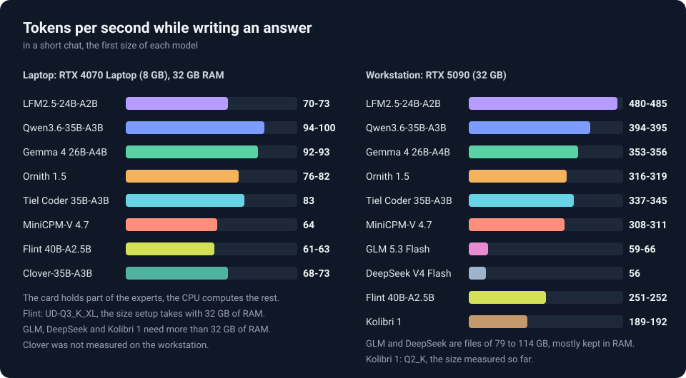

<h1 align="center">PolyStrata</h1>

[English](README.md) · [简体中文](README.zh-CN.md) · [日本語](README.ja.md) · [Deutsch](README.de.md) · [Français](README.fr.md) · [Español](README.es.md) · [Português](README.pt-BR.md) · **Türkçe**

<p align="center"><b>Büyük yapay zekâ modellerini kendi bilgisayarında çalıştır</b><br>
Qwen3.8-Flash-Next, GLM 5.3 Flash, DeepSeek V4 Flash, LFM2.5, Flint, Qwen3.6, Clover, Ornith 1.5, Gemma 4, Tiel Coder, MiniCPM-V ve Kolibri 1 · ücretsiz ve açık kaynak</p>

<p align="center"></p>

<p align="center"><br>
<sub>Claude Code, Qwen3.6-35B-A3B UD-Q3_K_M ile 8 GB kartlı dizüstünde, gerçek zamanlı: küçük bir programa <code>--json</code> seçeneği ekliyor, bunun için bir test yazıyor ve testleri çalıştırıyor. Sunucu, başlarken Claude Code'un sistem prompt'unu okumuştu (<code>"warm_start": true</code>).</sub></p>

<p align="center"><a href="https://github.com/Niko1221/Strata/releases/download/v0.1.10/Pagoda.mp4"></a><br>
<sub>Voksel bir pagoda bahçesi; tek bir prompt'la yazıldı, <a href="https://github.com/Niko1221/Strata">Strata</a> ile bir RTX 5070'te çalışıyor (Qwen3.8-Flash-Next IQ3_S, 128K bağlam) ·
<a href="https://github.com/Niko1221/Strata/releases/download/v0.1.10/Pagoda.mp4">videonun tamamı (49 sn)</a></sub></p>

PolyStrata, normalde bir sunucu gerektiren büyük yapay zekâ modellerini sıradan bir bilgisayarda çalıştırır. Bu
modeller sohbet eder, kod yazar, uygulamaların ve kodlama ajanlarınla birlikte çalışır. Hiçbir veri bilgisayarından
dışarı çıkmaz.

İki motor üzerinde on iki model çalıştırır:

- **[Qwen3.8-Flash-Next](https://huggingface.co/Qwen/Qwen3.8-Flash-Next)**: Windows veya Linux'ta, 12 GB ya da
  daha fazla belleği olan bir NVIDIA veya AMD ekran kartında. Resimleri de okur. Motoru
  [Strata](https://github.com/Niko1221/Strata) projesinin motorudur, değiştirilmeden kullanılır.

Diğer on biri, PolyStrata için yazılmış bir motorda, bir NVIDIA kartıyla ya da [iki](docs/MULTI_GPU.md#the-strata-poly-models) kartla çalışır: hepsi
Linux'ta, GLM 5.3 Flash ve DeepSeek V4 Flash dışındakiler Windows'ta da. Deneyseldirler: 32 GB kartlı tek bir
bilgisayarda, sekiz küçük olanı ayrıca 8 GB kartlı bir dizüstünde de çalıştırıldı.

- **[GLM 5.3 Flash](docs/models/glm.md)**, en büyükleri: 79 ila 114 GB'lık bir dosya, çoğu RAM'de kalır.
- **[DeepSeek V4 Flash](docs/models/deepseek.md)**, 91 GB'lık bir dosya; bunun da çoğu RAM'de kalır. Bir sohbeti
  hafızasında tutmak için az yer kaplar: 128K bağlam, 32K'ya göre yalnızca 0,7 GB daha fazla VRAM alır.
- **[LFM2.5-24B-A2B](docs/models/lfm25.md)**, Liquid AI tarafından geliştirildi: 11 ila 25 GB'lık bir dosya. Katmanlarının
  çoğunda attention yok, bu yüzden uzun bir sohbet az VRAM alır: 128K bağlam, 32K'ya göre 2 GB daha fazla alır.
  Lisansı, ticari kullanıma yalnızca yıllık geliri 10 milyon dolardan az olan şirketler için izin verir.
- **[Flint 40B-A2.5B](docs/models/flint.md)**, Recursive tarafından kodlama ajanları için geliştirildi: 18 ila 42 GB'lık
  bir dosya. Katmanlarının çoğu yalnızca 513 token geriye bakar, bu yüzden uzun bir sohbet az VRAM alır: 128K bağlam,
  32K'ya göre 2,6 GB daha fazla alır.
- **[Qwen3.6-35B-A3B](docs/models/qwen36.md)**, 13 ila 23 GB'lık bir dosya. Resimleri de okur.
- **[Clover-35B-A3B-Preview](docs/models/clover.md)**, DiffuSpace tarafından, bir seferde bir blok token da yazabilmesi
  için daha fazla eğitilmiş Qwen3.6-35B-A3B: 13 ila 21 GB'lık bir dosya. Yalnızca metin okur.
- **[Ornith 1.5](docs/models/ornith.md)**, Qwen3.6-35B-A3B'nin mimarisine ve farklı ağırlıklara sahip: 14 ila 24 GB'lık
  bir dosya. Resimleri de okur.
- **[Gemma 4 26B-A4B](docs/models/gemma4.md)**, 11 ila 17 GB'lık bir dosya. Resimleri de okur.
- **[Tiel Coder 35B-A3B](docs/models/tiel.md)**, Ornith 1.5'in peculiar-ragdoll tarafından kodlama ajanları için
  kuantize edilmiş hâli: 14 ila 23 GB'lık bir dosya. Resimleri de okur.
- **[MiniCPM-V 4.7 35B-A3B](docs/models/minicpmv.md)**, OpenBMB tarafından resim okumak için geliştirildi;
  Qwen3.6-35B-A3B'nin mimarisine ve kendine ait ağırlıklara sahip: 16 ila 29 GB'lık bir dosya.
- **[Kolibri 1](docs/models/kolibri.md)**, Aleph Alpha tarafından geliştirildi; İngilizcenin yanı sıra Almanca da yazar:
  29 ila 48 GB'lık bir dosya, çoğu küçük bir kartın yanında RAM'de kalır.

Sunucu, çalışırken kurulu modeller arasında geçiş yapabilir ([nasıl](docs/BACKENDS.md#changing-the-model)).

PolyStrata, [VecSzn](https://github.com/VecSzn) tarafından oluşturuldu.
PolyStrata, Niko1221'in [Strata](https://github.com/Niko1221/Strata) projesi üzerine kurulmuştur.
Neden ayrı bir depo olduğu, AMD ve daha küçük kartlar, ince ayarlı modeller (fine-tune) ve diğer sorular:
[SSS](docs/FAQ.md).

> Bu sayfanın bağlantı verdiği belgeler (model sayfaları ve `docs/` klasörü) İngilizcedir.

## Ne kadar hızlı?

Bir token, kabaca bir kelimenin dörtte üçü kadardır.

- **Yanıt yazma:** kısa bir sohbette yanıtın ne kadar hızlı belirdiği. Saniyede 60 token, senin okuyabileceğinden
  daha hızlıdır.
- **Prompt okuma:** gönderdiğin şeyi (bir belge, kod ya da bir sohbet geçmişi) ne kadar hızlı içine aldığı.

Tablo, her model için yükleyicinin seçtiği boyutu, saniyede token olarak verir. Tüm boyutların sayıları, llama.cpp ile karşılaştırma ve nasıl ölçüldükleri her modelin kendi sayfasında.

| Model | 8 GB kartlı dizüstü<br>yazma / okuma | RTX 5090<br>yazma / okuma | Tüm boyutlar |
| --- | ---: | ---: | --- |
| LFM2.5-24B-A2B | 70-73 / 3.590-3.620 | 480-485 / 23.390-23.460 | [LFM2.5](docs/models/lfm25.md) |
| Flint 40B-A2.5B | 61-63 / 2.000-2.010 | 251-252 / 12.900 | [Flint](docs/models/flint.md) |
| Qwen3.6-35B-A3B | 94-100 / 1.690 | 394-395 / 7.800-7.810 | [Qwen3.6](docs/models/qwen36.md) |
| Clover-35B-A3B-Preview | 68-73 / 1.560-1.700 | ölçülmedi | [Clover](docs/models/clover.md) |
| Ornith 1.5 | 76-82 / 1.620 | 316-319 / 8.040-8.110 | [Ornith](docs/models/ornith.md) |
| Gemma 4 26B-A4B | 92-93 / 2.240 | 353-356 / 8.420-8.480 | [Gemma 4](docs/models/gemma4.md) |
| Tiel Coder 35B-A3B | 83 / 1.700 | 337-345 / 8.080-8.110 | [Tiel Coder](docs/models/tiel.md) |
| MiniCPM-V 4.7 35B-A3B | 64 / 1.150 | 308-311 / 7.910-7.950 | [MiniCPM-V](docs/models/minicpmv.md) |
| Kolibri 1 | ölçülmedi | 189-192 / 4.980-5.070 | [Kolibri 1](docs/models/kolibri.md) |
| GLM 5.3 Flash | çalışmaz: 32 GB kart gerekir | 59-66 / 820 | [GLM](docs/models/glm.md) |
| DeepSeek V4 Flash | çalışmaz: 32 GB kart gerekir | 56 / 1.040 | [DeepSeek](docs/models/deepseek.md) |

Dizüstü: RTX 4070 Laptop (8 GB), Core i7-14700HX, 32 GB RAM. İş istasyonu: RTX 5090 (32 GB), Xeon Platinum 8470Q (25 vCPU), 90 ila 120 GB RAM. Flint, dizüstünde UD-Q3_K_XL boyutuyla (yükleyicinin 32 GB RAM ile seçtiği boyut), iş istasyonunda UD-Q4_K_XL boyutuyla ölçüldü. Kolibri 1, iş istasyonunda Q2_K boyutuyla ölçüldü; yükleyici orada Q4_K_M boyutunu seçer, bu boyut ölçülmedi.

Qwen3.8-Flash-Next, Strata projesinin motorunda çalışır ve o proje tarafından RTX 5070 (12 GB) ve 64 GB RAM'li bir bilgisayarda ölçüldü: IQ2_XS boyutu saniyede 79 token yazar ve 32K'lık bir prompt'u saniyede 2.090 token hızla okur ([tüm boyutlar](docs/models/qwen38.md)).

PolyStrata'nın kendi motorundaki on bir model, kendi bilgisayarında da çalıştırabileceğin benchmark aracıyla ölçüldü:
`python polystrata.py benchmark --model <name> --prompt-tokens 24000`
([ne gönderdiği ve ne yazdırdığı](docs/BACKENDS.md#benchmark)).
Başkalarının kendi kartlarında ölçtükleri ve kendi kartında llama.cpp ile nasıl karşılaştıracağın:
[topluluk sonuçları](docs/COMMUNITY_BENCHMARKS.md#the-models-polystrata-adds).
Dizüstünde, Qwen3.6 ve Tiel Coder ile PolyStrata, prompt'ları llama.cpp b11540 sürümüne göre 2,7 ila 3,5 kat daha
hızlı okudu ve 1,5 ila 1,8 kat daha hızlı yazdı ([iki çalıştırma](docs/COMMUNITY_BENCHMARKS.md#comparing-with-llamacpp)).

## Ne kadar RAM tutar?

0.1.45-poly.7 sürümünden beri on bir modelin motoru RAM'inin daha azını tutuyor: model dosyasının zaten ekran
kartında olan kısımlarını artık RAM'de tutmuyor. Dizüstünde Qwen3.6-35B-A3B, 32.000 token'lık bir prompt'tan sonra
0.1.45-poly.6 ile 17,9 GiB tutuyordu; şimdi 13,1 GiB tutuyor ve aynı hızda yazıyor. Linux'ta 17,8 GiB yerine
12,6 GiB.

Daha azını tutması için `strata-<model>.json` dosyasındaki `"args"` listesine `"--ram-experts-mib", "6144"` ekle
([nerede](docs/INSTALL.md#where-things-are-stored)) ve yeniden başlat. Motor bundan sonra VRAM dışında kalan uzmanlar
(experts) için, yanıt verirken de, RAM'de bu kadar MiB tutar ve başlarken bunu söyler. Geri kalanlar sistemin dosya
önbelleğinde kalır; orada diğer programların bu belleği kullanabilir ve bir token onlara ihtiyaç duyduğunda oradan
okunurlar. Daha yavaş yazdığı için varsayılan olarak kapalıdır ve bunun üzerinde hâlâ çalışıyoruz. Dizüstünde
(RTX 4070 Laptop 8 GB, 32 GB RAM, Windows 11), Qwen3.6-35B-A3B UD-Q3_K_M:

| | varsayılan | `--ram-experts-mib 6144` |
| --- | ---: | ---: |
| Motorun yüklendikten sonra tuttuğu RAM | 11,7 GiB | **6,5 GiB** |
| yazarken en fazla: kısa sohbet / 32K prompt'tan sonra | 14,3 / 14,0 GiB | **6,7 / 7,3 GiB** |
| istekler arasında | 12,8 GiB | **7,1 GiB** |
| Yazma, token/sn: ilk kısa sohbet | 71,6 | 69,4 (%3 daha yavaş) |
| 32K prompt'tan sonra | 65,4 | 63,7 (%3 daha yavaş) |
| ondan sonraki kısa bir sohbet | 84,2 | 72,9 (%13 daha yavaş) |
| uzun bir yanıt (kısa bir sohbette 1.024 token) | 90,6 | 78,3 (%14 daha yavaş) |

Bu çalıştırmada kartın VRAM'inin bir kısmını başka programlar tutuyordu, bu yüzden iki sütun da kart boşken
olduğundan daha yavaş yazıyor. Diğer iki çalıştırmada 32K prompt'tan sonra %6 ila 8, ondan sonraki sohbette %8 ila 10
daha yavaş yazdı. Linux'ta (yaklaşık 8 GB ile sınırlanmış bir RTX PRO 6000) 12,3 ila 14,3 GiB yerine 7,0 ila 7,7 GiB
tuttu ve %7 ila 14 daha yavaş yazdı. Uzman önbelleği sabit tutulduğunda (bir sürüm kontrol edilirken yapıldığı gibi),
yanıtlar token token aynıdır.

Motor ayrıca prompt okumak için 350 ila 400 MiB daha az VRAM'e ihtiyaç duyar: bu alanı uzman önbelleği kullanır
(Qwen3.6, VRAM'de 2.444 yerine 2.712 uzman tutar) ya da `--vram-reserve-mib` onu diğer programlara bırakır.
Nasıl çalıştığı ve nasıl ölçüldüğü: [docs/BACKENDS.md](docs/BACKENDS.md#less-of-the-pcs-ram-and-vram).

## Neye ihtiyacın var?

| Model | Ekran kartı | RAM (yükleyicinin seçtiği boyut için) | Disk | Sistem |
| --- | --- | --- | --- | --- |
| [Qwen3.8-Flash-Next](docs/models/qwen38.md) | NVIDIA RTX 20 ila 50 serisi ya da AMD RX 6800 / 6900, RX 7700 XT / 7800 XT / 7900 XT / XTX, RX 9060 XT / 9070 / 9070 XT, Radeon AI PRO R9700; 12 GB veya daha fazla | 32 GB veya daha fazla; 64 GB ile her boyut çalışır | yaklaşık 80 GB | Windows, Linux |
| [GLM 5.3 Flash](docs/models/glm.md) | NVIDIA RTX 20 serisi veya daha yenisi; yalnızca 32 GB'lık bir kartta çalıştırıldı | 32 GB'lık bir kartın yanında 96 GB | 79 ila 114 GB, bir SSD'de | Linux |
| [DeepSeek V4 Flash](docs/models/deepseek.md) | yukarıdakiyle aynı | 32 GB'lık bir kartın yanında 72 GB | 91 GB, bir SSD'de | Linux |
| [LFM2.5-24B-A2B](docs/models/lfm25.md) | NVIDIA RTX 20 serisi veya daha yenisi, 8 GB veya daha fazla | 8 GB'lık bir kartın yanında yaklaşık 20 GB | 11 ila 25 GB | Windows, Linux |
| [Flint 40B-A2.5B](docs/models/flint.md) | yukarıdakiyle aynı | 8 GB'lık bir kartın yanında yaklaşık 22 GB | 18 ila 42 GB | Windows, Linux |
| [Qwen3.6-35B-A3B](docs/models/qwen36.md) | yukarıdakiyle aynı; AMD beta olarak | 8 GB'lık bir kartın yanında yaklaşık 21 GB | 13 ila 23 GB | Windows, Linux |
| [Clover-35B-A3B-Preview](docs/models/clover.md) | NVIDIA RTX 20 serisi veya daha yenisi, 8 GB veya daha fazla | 8 GB'lık bir kartın yanında yaklaşık 20 GB | 13 ila 21 GB | Windows, Linux |
| [Ornith 1.5](docs/models/ornith.md) | yukarıdakiyle aynı; AMD beta olarak | 8 GB'lık bir kartın yanında yaklaşık 22 GB | 14 ila 24 GB | Windows, Linux |
| [Gemma 4 26B-A4B](docs/models/gemma4.md) | yukarıdakiyle aynı; AMD beta olarak | 8 GB'lık bir kartın yanında yaklaşık 18 GB | 11 ila 17 GB | Windows, Linux |
| [Tiel Coder 35B-A3B](docs/models/tiel.md) | yukarıdakiyle aynı; AMD beta olarak | 8 GB'lık bir kartın yanında yaklaşık 21 GB | 14 ila 23 GB | Windows, Linux |
| [MiniCPM-V 4.7 35B-A3B](docs/models/minicpmv.md) | yukarıdakiyle aynı; AMD beta olarak | 8 GB'lık bir kartın yanında yaklaşık 25 GB | 16 ila 29 GB | Windows, Linux |
| [Kolibri 1](docs/models/kolibri.md) | NVIDIA RTX 20 serisi veya daha yenisi, 8 GB veya daha fazla | 8 GB'lık bir kartın yanında yaklaşık 33 GB | 29 ila 48 GB | Windows, Linux |

RAM değeri yükleyicinin tahminidir; daha büyük bir kartla daha azı gerekir. Geri kalan her şeyi yükleyici kurar: Windows'ta motoru hazır derlenmiş olarak indirir; yalnızca AVX2 desteği olmayan bir işlemcide ya da senin kopyandaki motor son sürümden daha yeniyse onu bilgisayarında derler ve gereken araçları kurmayı önerir. İki ya da üç kart bir modeli paylaşabilir ([çoklu GPU](docs/MULTI_GPU.md)). Eski ekran kartları, Intel Arc, Apple Silicon Mac'ler (yalnızca Qwen3.8-Flash-Next), Strix Halo ve AVX2 desteği olmayan eski işlemciler: [tam liste](docs/INSTALL.md#what-you-need). Her modelin kart, RAM ve boyut ayrıntıları kendi sayfasında.

Qwen3.6, Clover, Ornith 1.5, Gemma 4, Tiel Coder ve MiniCPM-V'nin her birinin neye ihtiyaç duyduğu ve bunun nasıl kontrol edildiği: [docs/BACKENDS.md](docs/BACKENDS.md#install).

## Kurulum

### Kurulumu yapay zekâna yaptır

Bir yapay zekâ kodlama asistanı (Claude Code, Cursor, Codex, GitHub Copilot, ...) kullanıyor musun? Şunu ona yapıştır:

```text
Set up PolyStrata on this PC for me: https://github.com/simplexai-labs/PolyStrata - follow docs/AI_SETUP.md in that repository.
```

Asistan ekran kartını, RAM'ini ve diskini kontrol eder ve sana uyan modeli seçer. Sonra onu kurar, başlatır ve
uygulamalarını nasıl bağlayacağını söyler. Yapay zekâ araçları PolyStrata'yı [MCP sunucusu](docs/MCP_SERVER.md)
üzerinden de kurabilir, başlatabilir ve durdurabilir.

### Ya da kendin yap

[PolyStrata'yı indir](https://github.com/simplexai-labs/PolyStrata/archive/refs/heads/main.zip) ve zip'ten çıkar (ya da `git clone` ile klonla).
**Windows:** **`START-HERE.bat`** dosyasına çift tıkla. **Linux:** PolyStrata klasöründe **`./setup.sh`** komutunu çalıştır.

**Mac (Apple Silicon, M1 ila M5, macOS 15 veya daha yenisi):** Apple'ın Command Line Tools paketini bir kez kur
(Terminal'de `xcode-select --install`; Xcode'un kendisine gerek yok). Sonra PolyStrata klasöründe Terminal'i aç ve
**`./setup.sh`** komutunu çalıştır. Mac motorunu Mac'inde derler (yaklaşık 7 dakika), aynı soruları sorar, modeli
indirir ve başlatır. Bir dahaki sefere `./setup.sh` onu hemen başlatır. Mac'ine hangi boyutun uyduğu ve ne kadar hızlı
olduğu: [docs/MAC.md](docs/MAC.md). Mac motoru yalnızca Qwen3.8-Flash-Next'i çalıştırır; diğer on bir model bir NVIDIA
veya AMD kart gerektirir.

Yükleyici kartını bulur ve ona uygun motoru kurar. Sana birkaç soru sorar:

- hangi model ve hangi boyut,
- ne kadar bağlam (modelin aklında ne kadar metin tuttuğu),
- resimleri okuyup okumayacağı (GLM 5.3 Flash, DeepSeek V4 Flash, LFM2.5, Flint, Clover ve Kolibri 1 resim okumaz).

Önerilen yanıt için her seferinde Enter'a bas. Ardından modeli indirir (Qwen3.8-Flash-Next için yaklaşık 70 GB,
GLM 5.3 Flash için 79 ila 114 GB, DeepSeek V4 Flash için 91 GB, Kolibri 1 için 29 ila 48 GB, diğer sekizi için 11 ila 42 GB) ve başlatır. İndirme yarıda kalırsa yeniden çalıştır:
kaldığı yerden devam eder. Tarayıcın PolyStrata uygulamasını `http://127.0.0.1:8080` adresinde açar.

On ikisinin hepsi yükleyicinin model listesinde. `./setup.sh --family glm`, `deepseek`, `lfm25`, `flint`, `qwen36`, `clover`, `ornith`,
`gemma4`, `tiel`, `minicpmv` veya `kolibri` doğrudan o modele gider ([ne sorduğu ve ne yazdığı](docs/GLM.md#install)).

> **Model başlarken bilgisayarın 1-3 dakika boyunca yavaşlayabilir ya da yanıt vermeyebilir** (en uzunu ilk seferde).
> PolyStrata RAM'ine 35-55 GB yükler ve bir kısmını ekran kartı için kilitler. Bu normaldir. Bekle ve pencereyi
> kapatma. Pencere PolyStrata'nın ne yaptığını gösterir.

**Bir dahaki sefere** `START-HERE.bat` dosyasını (ya da `./setup.sh` komutunu) yeniden çalıştır. Hemen başlar ve
hiçbir şeyi iki kez indirmez. Modeli durdurmak için penceresini kapat. `UPDATE.bat` (`./update.sh`) PolyStrata'yı
başlatmadan günceller. Güncelleme, Docker, birden fazla kart, dosyaların nereye gittiği ve tüm seçenekler:
[docs/INSTALL.md](docs/INSTALL.md).

**Senin bilgisayarında hızlı mı?** `BENCH.bat` (`./bench.sh`) çalıştır: yaklaşık 5-10 dakika sürer; kendi ayarlarınla sohbeti, 4K/16K prompt'ları ve ajan tarzı bir oturumu ölçer ve paylaşabileceğin bir rapor yazar ([nasıl](docs/COMMUNITY_BENCHMARKS.md#run-the-benchmark)).

## Hangi modeli seçmeliyim?

Aynı model, az ya da çok sıkıştırılmış birkaç boyutta gelir: küçük boyutlar daha hızlıdır ve daha az RAM ister, büyükler ise orijinale daha yakındır. Enter'a bastığında yükleyici RAM'ine ve kartına uygun olanı seçer; başka bir boyut için kurarken `--model <boyut>` ekle.

| Model | Yükleyicinin seçtiği | Daha az RAM ile | Adıyla seçilebilenler |
| --- | --- | --- | --- |
| [Qwen3.8-Flash-Next](docs/models/qwen38.md) | 32 GB RAM: Coder; 48 ila 64 GB: IQ2_XS; 96 GB veya daha fazla: IQ3_S |  | Q2_0, IQ3_XXS, Unsloth'un 4 ila 8 bitlik dosyaları |
| [GLM 5.3 Flash](docs/models/glm.md) | 3.0BIT | UD-IQ2_XXS, sonra REAP50-Q3_K_M |  |
| [DeepSeek V4 Flash](docs/models/deepseek.md) | UD-IQ2_XXS (tek boyut) |  |  |
| [LFM2.5-24B-A2B](docs/models/lfm25.md) | UD-Q4_K_XL | UD-Q3_K_XL | QAD-Q4_0, UD-Q6_K_XL, Q8_0 |
| [Flint 40B-A2.5B](docs/models/flint.md) | yaklaşık 40 GB RAM'den itibaren UD-Q4_K_XL | UD-Q3_K_XL | UD-Q6_K_XL, Q8_0 |
| [Qwen3.6-35B-A3B](docs/models/qwen36.md) | UD-Q3_K_M | UD-Q2_K_XL | UD-Q4_K_M |
| [Clover-35B-A3B-Preview](docs/models/clover.md) | Q3_K_M | APEX-I-NANOPLUS | Q4_K_M |
| [Ornith 1.5](docs/models/ornith.md) | APEX-I-COMPACT | APEX-I-MINI | APEX-I-QUALITY |
| [Gemma 4 26B-A4B](docs/models/gemma4.md) | UD-Q3_K_M | UD-Q2_K_XL | UD-Q4_K_M, QAT-UD-Q4_K_XL |
| [Tiel Coder 35B-A3B](docs/models/tiel.md) | UD-Q3_K_XL | UD-IQ3_XXS | UD-Q4_K_XL |
| [MiniCPM-V 4.7 35B-A3B](docs/models/minicpmv.md) | Q4_K_M | mix_q3gud_im | Q6_K |
| [Kolibri 1](docs/models/kolibri.md) | yaklaşık 48 GB RAM'den itibaren Q4_K_M | Q2_K | Q3_K_M |

Her boyutun ne olduğu, indirme bilgisi, başka kartların yanında ne kadar RAM istediği ve en büyük boyuta ne kadar yaklaştığı: her modelin kendi sayfasında; sayfalara "Ne kadar hızlı?" başlığının altındaki tablodan ulaşabilirsin.

## Kullanım

On iki modelin hepsi aynı şekilde kullanılır: aynı uygulama, aynı API.

<p align="center"><br>
<sub>Bir kodlama ajanı videodaki pagoda bahçesini yazarken (sağda) uygulamanın <b>Monitor</b> sekmesi (solda). Ekran görüntüsü <a href="https://github.com/Niko1221/Strata">Strata</a> projesinden.</sub></p>

- **Tarayıcıda:** `http://127.0.0.1:8080` adresini aç. Uygulamada **Chat**, modeli ve GPU/CPU/RAM kullanımını canlı
  gösteren **Monitor** ve ayarlarla adresleri gösteren **About** sekmeleri var.
- **Uygulamaların ve kodlama ajanların:** temel URL'si **`http://127.0.0.1:8080/v1`** olan "OpenAI-compatible" bir
  sağlayıcı ekle. Herhangi bir API anahtarı ve herhangi bir model adı çalışır.
  - Anthropic'in API'sini kullanan uygulamalar: `http://127.0.0.1:8080/v1/messages` (Claude Code:
    `ANTHROPIC_BASE_URL=http://127.0.0.1:8080` ve `strata-<model>.json` içinde `"fit_max_tokens": true`
    ([neden](docs/FAQ.md#can-i-use-it-with-claude-code-codex-or-other-apps))).
  - Codex CLI ve OpenAI Responses API'yi kullanan diğer uygulamalar: `/v1/responses`
    ([kurulum](docs/DETAILS.md#the-responses-api-and-codex-cli)).
- **Düşünme:** sohbet menüsünde ya da uygulamanın "reasoning effort" ayarında **off, low, medium veya high** (kapalı,
  düşük, orta, yüksek) seç. Off en hızlısıdır. High zor sorular için en iyisidir.
- **Telefonundan ya da başka bir bilgisayardan:** `START-HERE.bat --setup --host 0.0.0.0 --api-key <gizli-anahtar>`.
  Her zaman bir anahtar belirle.

Farklı oldukları yerler:

| | Qwen3.8-Flash-Next | GLM 5.3 Flash | DeepSeek V4 Flash | LFM2.5-24B-A2B | Flint 40B-A2.5B | Kolibri 1 | Qwen3.6-35B-A3B, Clover-35B-A3B-Preview, Ornith 1.5, Gemma 4 26B-A4B, Tiel Coder 35B-A3B, MiniCPM-V 4.7 35B-A3B |
| --- | --- | --- | --- | --- | --- | --- | --- |
| **Resimler** | Kurulumda "Images?" sorusuna evet de. Sonra sohbette **Picture** düğmesine tıkla ya da uygulamanda resim ekle. AMD kartlar Linux'ta resimleri işlemci üzerinden okur; Windows'ta henüz okuyamaz. | Henüz değil. | Yalnızca metin okur. | Yalnızca metin okur. | Yalnızca metin okur. | Yalnızca metin okur. | Kurulumda "Images?" sorusuna evet de; sonrası Qwen3.8-Flash-Next ile aynı. 16 GB'tan az belleği olan bir kartta resim kodlayıcı işlemcide çalışır ve bir resim birkaç saniye sürer. Clover yalnızca metin okur. |
| **Birden fazla istek** | Varsayılan olarak aynı anda bir tane; diğerleri bekler. `"parallel": 2` birkaçını aynı anda yanıtlar ([BATCHING.md](docs/BATCHING.md)); 12 GB'lık bir kartta her yanıt yavaşlar. | Aynı anda bir tane; diğerleri bekler. | Aynı anda bir tane; diğerleri bekler. | Aynı anda bir tane; diğerleri bekler. | Aynı anda bir tane; diğerleri bekler. | Aynı anda bir tane; diğerleri bekler. | Aynı anda bir tane; diğerleri bekler. |
| **Birden fazla sohbet** | Sonuncusu saklanır, böylece devam mesajları saniyeler içinde başlar. İki motor argümanı birkaçını RAM'de tutar ([ayrıntılar](docs/DETAILS.md#using-it)). | Sonuncusu saklanır. Kurulum, birkaçının RAM'de tutulup tutulmayacağını sorar; böylece bir ajan ve alt ajanları, prompt'ları yeniden okunmadan sırayla çalışabilir ([nasıl](docs/GLM.md#several-conversations-at-once)). | GLM 5.3 Flash ile aynı. | GLM 5.3 Flash ile aynı. | GLM 5.3 Flash ile aynı. | GLM 5.3 Flash ile aynı. | GLM 5.3 Flash ile aynı. |
| **Uzun prompt'lar** | Bir sohbetin ilk mesajı baştan sona okunur; 30.000 token başına yaklaşık 1 dakika. | İlk mesaj baştan sona okunur; 30.000 token başına yaklaşık 40 saniye. | İlk mesaj baştan sona okunur; 30.000 token başına yaklaşık 29 saniye. | İlk mesaj baştan sona okunur: 30.000 token, iş istasyonunda 1,3 ila 1,5 saniye, 8 GB'lık dizüstünde 8 ila 10 saniye sürer. | İlk mesaj baştan sona okunur: 30.000 token, iş istasyonunda yaklaşık 2,3 saniye, 8 GB'lık dizüstünde 15 ila 22 saniye sürer. | İlk mesaj baştan sona okunur: 30.000 token, iş istasyonunda Q2_K ile yaklaşık 6 saniye sürer. | İlk mesaj baştan sona okunur: 30.000 token, iş istasyonunda 4 ila 5 saniye, 8 GB'lık dizüstünde 14 ila 27 saniye sürer. |

Daha fazlası: [sohbetlerin nerede saklandığı](docs/INSTALL.md#where-things-are-stored), [API](docs/DETAILS.md#using-it).

### İsteğe bağlı: model RAM'e tamamen sığdığında tek kartta daha fazla hız

İsteğe bağlı olarak açılan iki ayar (RubenTorney tarafından, #1904 ve #1905). Tek bir ekran kartı kullandığında ve
RAM'in tüm uzmanları tutabildiğinde işe yararlar (PolyStrata'nın arena modu, örneğin 64 GB'lık bir bilgisayarda Q2_0
veya IQ3_XXS). PolyStrata veri klasöründeki yapılandırma dosyan olan `strata-<model>.json` dosyasını aç
([nerede](docs/INSTALL.md#where-things-are-stored)) ve şunları ekle:

- **Daha hızlı yanıt üretme (decode):** `"args"` listesine `"--adapt-async", "1"`. Uzman önbelleği böylece yanıtı
  duraklatmak yerine yardımcı bir iş parçacığında güncellenir. Bir RTX 5070'te ölçüldü (Windows, Q2_0): decode'da
  %4-5, kodda ve uzun belgelerde %7-10 artış. Yanıtlar varsayılandan biraz farklı olabilir (çalıştırmadan
  çalıştırmaya aynı kalırlar).
- **Windows'ta daha hızlı prompt okuma:** `"env"` bloğuna `"STRATA_PIN_BY_NEED": "1"`. Windows, RAM'in yalnızca
  yaklaşık yarısını ekran kartı için kilitleyebilir; bu ayar, kartın gerçekten ihtiyaç duyduğu uzmanları önce kilitler.
  RTX 5070'te ölçüldü: prompt okumada %4,4 artış.

```json
"args": [ ..., "--adapt-async", "1" ],
"env": { "STRATA_PIN_BY_NEED": "1" }
```

Değişiklikten sonra PolyStrata'yı yeniden başlat (`START-HERE.bat` veya `./setup.sh`). Geri almak için iki girdiyi sil.

## Bir sorun mu çıktı?

- **PolyStrata ilk kez başladığında bilgisayarım dondu.** Model yüklenirken bu normaldir. Bekle ve pencereyi kapatma.
  10 dakika sonra hâlâ donuk mu? Bilgisayarı yeniden başlat, diğer programları kapat ve tekrar dene ya da daha küçük
  bir boyut seç.
- **İndirme ya da kurulum sırasında durdu.** `START-HERE.bat` dosyasını (ya da `./setup.sh` komutunu) yeniden
  çalıştır. Kaldığı yerden devam eder.
- **Çok yavaş ve disk ışığı sürekli yanıp sönüyor ya da "the engine stopped unexpectedly" (motor beklenmedik şekilde
  durdu) diyor.** Bilgisayarında yeterince boş RAM yok. Diğer programları kapat (tarayıcılar çok kullanır) ya da daha
  küçük bir boyut seç (Q2_0 veya IQ2_XS).
- **8080 portunun zaten kullanımda olduğunu söylüyor.** PolyStrata zaten çalışıyor. Penceresini ara.

Diğer sorunlar ve çözümleri: [docs/TROUBLESHOOTING.md](docs/TROUBLESHOOTING.md). Hâlâ takıldın mı? Bir
[issue](https://github.com/simplexai-labs/PolyStrata/issues) aç ve PolyStrata klasöründeki `strata-<model>.log` dosyasını ekle.
Bir güvenlik sorunu mu buldun? Gizli olarak bildir: [SECURITY.md](SECURITY.md).

## Nasıl çalışıyor?

Bu tür modeller genellikle yüzlerce gigabayt grafik belleği olan sunucularda çalışır. Senin ekran kartında 8-32 GB
var. PolyStrata, **işi tüm bilgisayarına paylaştırarak** modeli sığdırır. Bir mutfak düşün: sürekli kullandığın
şeyler tezgâhta durur, geri kalanı kilerde bekler.

Her modelin diyagramı ve nasıl çalıştığı: [docs/HOW_IT_WORKS_MODELS.md](docs/HOW_IT_WORKS_MODELS.md).

## Emeği geçenler ve lisans

Qwen3.8-Flash-Next, [Qwen ekibi](https://huggingface.co/Qwen/Qwen3.8-Flash-Next) tarafından geliştirildi.
[ISTA-DASLab](https://huggingface.co/ISTA-DASLab/Qwen3.8-Flash-Next-GSQ-RCO-GGUF), UkisAI (Swift 1.5) ve Unsloth
tarafından sıkıştırıldı.
GLM 5.3 Flash;
[neuralll](https://huggingface.co/neuralll/GLM-5.3-Flash-GSQ-RCO-3.0bit-Q4Kattn-GGUF), Unsloth ve patrickbdevaney
tarafından hazırlanan dosyalarla çalışır.
Qwen3.6-35B-A3B Qwen ekibi, Gemma 4 Google, DeepSeek V4 Flash ise DeepSeek tarafından geliştirildi; üçü de
[Unsloth](https://huggingface.co/unsloth) kuantizasyonuyla kullanılıyor. LFM2.5-24B-A2B,
[Liquid AI](https://huggingface.co/LiquidAI/LFM2.5-24B-A2B) tarafından geliştirildi; Unsloth kuantizasyonuyla ve
Liquid AI'ın kendi QAD-Q4_0 sürümüyle kullanılıyor. Flint 40B-A2.5B, [Recursive](https://huggingface.co/RecursiveSI/flint)
tarafından geliştirildi; Unsloth kuantizasyonuyla kullanılıyor.
Kolibri 1, [Aleph Alpha](https://huggingface.co/Aleph-Alpha/Kolibri-1) tarafından geliştirildi;
[Hob-forge](https://huggingface.co/Hob-forge/Kolibri-1-GGUF) tarafından yapılan GGUF dönüşümüyle kullanılıyor.
Clover-35B-A3B-Preview, [DiffuSpace](https://huggingface.co/Diffuspace/Clover-35B-A3B-Preview) tarafından geliştirildi;
[maternion](https://huggingface.co/maternion/Clover-35B-A3B-Preview-GGUF) kuantizasyonuyla ve IsValorum'un APEX sürümüyle kullanılıyor.
Ornith 1.5, ornith-ai tarafından geliştirildi;
[mudler](https://huggingface.co/mudler/Ornith-1.5-35B-A3B-APEX-MTP-GGUF) tarafından yapılan APEX kuantizasyonuyla kullanılıyor.
Tiel Coder 35B-A3B, Ornith 1.5 modelinin
[peculiar-ragdoll](https://huggingface.co/peculiar-ragdoll/Tiel-Coder-35B-A3B-GGUF-MTP) tarafından kuantize edilmiş hâlidir;
PolyStrata'da çalıştığını [u/Sensitive_Song4219](https://www.reddit.com/r/LocalLLM/comments/1x22inc/comment/pf3r111/) keşfetti.
MiniCPM-V 4.7 35B-A3B, [OpenBMB](https://huggingface.co/openbmb/MiniCPM-V-4.7-35B-A3B-gguf) tarafından geliştirildi
ve kendi kuantizasyonlarıyla kullanılıyor; PolyStrata'ya [iMilnb](https://github.com/iMilnb) getirdi.
PolyStrata, Niko1221 ve katkıda bulunanların geliştirdiği
[Strata](https://github.com/Niko1221/Strata) üzerine kurulmuştur ve
[llama.cpp / ggml](https://github.com/ggml-org/llama.cpp) projesinin bazı parçalarını kullanır. Emeği geçenlerin tamamı:
[docs/HOW_IT_WORKS.md](docs/HOW_IT_WORKS.md#credits). PolyStrata, [MIT Lisansı](LICENSE) altında açık kaynaktır.
Birkaç parçanın ve tüm modellerin kendi lisansları vardır ([hangileri](docs/HOW_IT_WORKS.md#license)).
